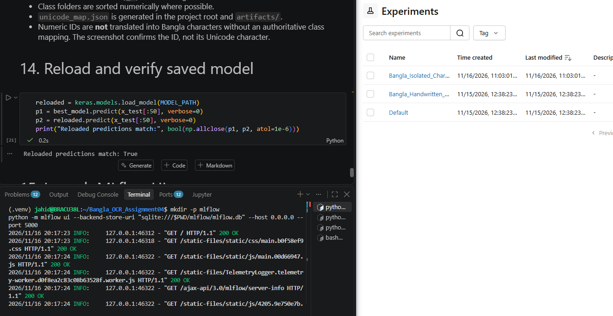
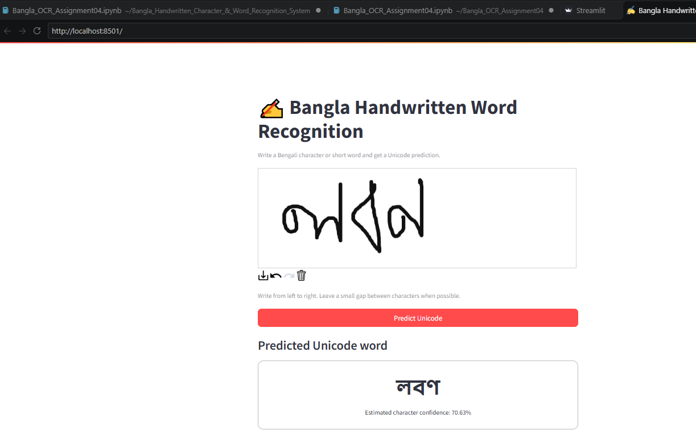

# Assignment : Bangla Handwritten Word Recognition System

**Student Name:** Md. Jahid Gazi  
**Student ID:** 1000128068  
**Program:** Skills for Industry Competitiveness and Innovation Program (SICIP)  
**Institution:** BRAC University  
** Bangla Handwritten Word Recognition System  
**Deadline:** 17 November 2026

---

## 1. Project objective

Build a Bangla handwritten word recognition system using the **BanglaLekha-Isolated** dataset. The project includes model training, MLflow experiment tracking, a Streamlit drawing interface, and Docker deployment.

The application must accept a handwritten Bangla word and display the predicted **complete joined word** in Bengali Unicode.

Examples of the required output:

| Handwritten input | Expected output |
|---|---|

| জল | জল |

Displaying only separate character predictions without producing the joined word does not satisfy the whole-word output requirement.

## 2. Dataset

- **Dataset:** BanglaLekha-Isolated
- **Source:** [Mendeley Data — BanglaLekha-Isolated](https://data.mendeley.com/datasets/hf6sf8zrkc/2)

Download the dataset from the source and arrange it in the directory structure expected by `train.py`. The dataset is not included in the source-code submission ZIP.

The current training configuration recorded in MLflow used:

- Training images: 116,273
- Validation images: 24,916
- Number of classes: 84
- Input image size: 64 × 64

Keep `labels.json` and the class-to-Unicode mapping used by the application consistent with the trained model. Do not infer Bengali Unicode labels from numeric folder names unless the mapping has been verified.

## 3. Approach and implementation

### Model

- Architecture: 3-block Convolutional Neural Network (CNN)
- Input size: 64 × 64
- Output classes: 84
- Dataset: BanglaLekha-Isolated

The CNN is trained to classify isolated Bangla character images. The application processes a user's handwritten input, predicts character classes, maps them to Bengali Unicode, and displays a joined Unicode string.

**Important limitation:** BanglaLekha-Isolated is an isolated-character dataset. It does not, by itself, provide complete handwritten-word samples and word-level transcriptions. Therefore, character classification followed by segmentation and concatenation is a baseline approach, not an end-to-end word-recognition model. Segmentation and character mapping can fail on connected handwriting, vowel signs (কার), conjuncts (যুক্তবর্ণ), phala, and touching strokes. The displayed complete word is the application's predicted output; it should not be presented as guaranteed correct recognition.

## 4. Project files

The assignment requires the following files in the GitHub project:

```text
bangla-ocr-assignment/
├── train.py
├── app.py
├── requirements.txt
├── Dockerfile
├── README.md
├── labels.json
├── models/
│   └── model.keras
├── artifacts/
│   └── mlflow/
└── screenshots/
    ├── streamlit_app.png
    └── mlflow_experiment.png
```

The screenshots folder may contain multiple experiment and application screenshots. The source-code ZIP submitted for the assignment must follow the source-only exclusion rules in Section 10.

## 5. Environment setup

Create and activate a Python virtual environment:

```bash
python -m venv .venv
```

Windows PowerShell:

```powershell
.venv\Scripts\Activate.ps1
```

Linux / WSL:

```bash
source .venv/bin/activate
```

Install dependencies:

```bash
python -m pip install --upgrade pip
pip install -r requirements.txt
```

## 6. Train the model and record MLflow experiments

Run the training script from the project root:

```bash
python train.py
```

Running `train.py` must train the model and record the experiment in MLflow.

The project has two completed MLflow runs captured in the supplied screenshots.

### Actual MLflow experiment results

| Field | Run 1: `experiment_1_baseline` | Run 2: `experiment_2_lower_learning_rate` |
|---|---:|---:|
| Status | FINISHED | FINISHED |
| Dataset | 116,273 train + 24,916 validation | 116,273 train + 24,916 validation |
| Model architecture | 3-block CNN | 3-block CNN |
| Image size | 64 × 64 | 64 × 64 |
| Number of classes | 84 | 84 |
| Epochs | 8 | 10 |
| Batch size | 64 | 64 |
| Learning rate | 0.001 | 0.0005 |
| Training loss | 0.8614 | 0.9207 |
| Training accuracy | 75.61% | 74.19% |
| Validation loss | 0.5919 | 0.6648 |
| Validation accuracy | 83.79% | 82.12% |

**Result interpretation:** Run 1 achieved the higher validation accuracy (83.79%) and lower validation loss (0.5919). Run 2 used a lower learning rate and more epochs, but its recorded validation accuracy was lower (82.12%). These values are transcribed from the supplied MLflow screenshots.

### Start the MLflow UI

From the project directory, run:

```bash
mlflow ui --host 0.0.0.0 --port 5000
```

Open the MLflow interface at:

[http://localhost:5000](http://localhost:5000)

The MLflow UI must use the same tracking store configured in `train.py`. If the code sets a custom tracking URI, start the UI against that same store.

## 7. Run the Streamlit application

Run:

```bash
streamlit run app.py
```

Open the application at:

[http://localhost:8501](http://localhost:8501)

Draw one Bangla word in the canvas and select **Predict Unicode**. The application should display the predicted complete joined Bangla Unicode word.

The screenshots in `screenshots/` provide examples of the application's prediction interface and output. Screenshots are evidence of the displayed examples; they do not prove that all handwriting styles or words will be recognized correctly.

## 8. Docker build and run

Build the Docker image using the assignment's image tag:

```bash
docker build -t bangla-ocr-app:0.1 .
```

Run the container:

```bash
docker run -p 8501:8501 bangla-ocr-app:0.1
```

Open:

[http://localhost:8501](http://localhost:8501)

Ensure the Dockerfile installs the required dependencies, exposes port `8501`, and starts the Streamlit application. The application must have access to the model and mapping files it needs at runtime. Do not include the dataset in the source-only submission ZIP.

## 9. Screenshots:

Include screenshots in the GitHub repository showing:

- The MLflow experiment page with at least two training runs.
- The Streamlit page with a handwritten Bangla word and its predicted complete Bangla Unicode output.

### MLflow Training Experiments

**Run 1 – Baseline Experiment**



**Run 2 – Lower Learning Rate**


**Additional MLflow Evidence**


### Streamlit Application

**Prediction Example 1**


**Prediction Example 2**



**Prediction Example 3**


## 11. GitHub repository: 

https://github.com/md-jahid-gazi/Bangla_Handwritten_Character_-_Word_Recognition_System


## 12. Limitations

- The CNN is trained on isolated character images, rather than complete handwritten-word images.
- Word segmentation and concatenation may not correctly handle connected Bangla handwriting.
- Vowel signs, conjuncts, phala, overlapping strokes, and small gaps can affect segmentation and recognition.
- Unicode output depends on a correct and complete class-to-Unicode mapping.
- The recorded validation accuracy measures the isolated-character classification task; it is not a word-level OCR accuracy score.

A future improvement is to train and evaluate a sequence-based word recognition model using a dataset with complete handwritten-word images and corresponding word-level transcriptions.


