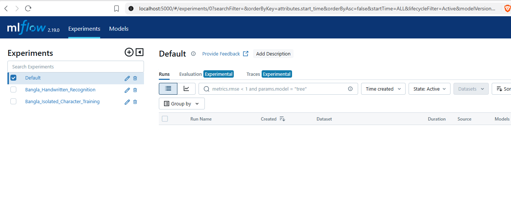
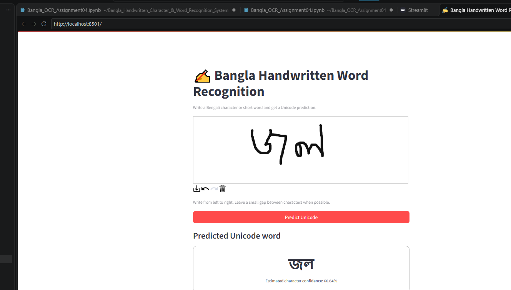
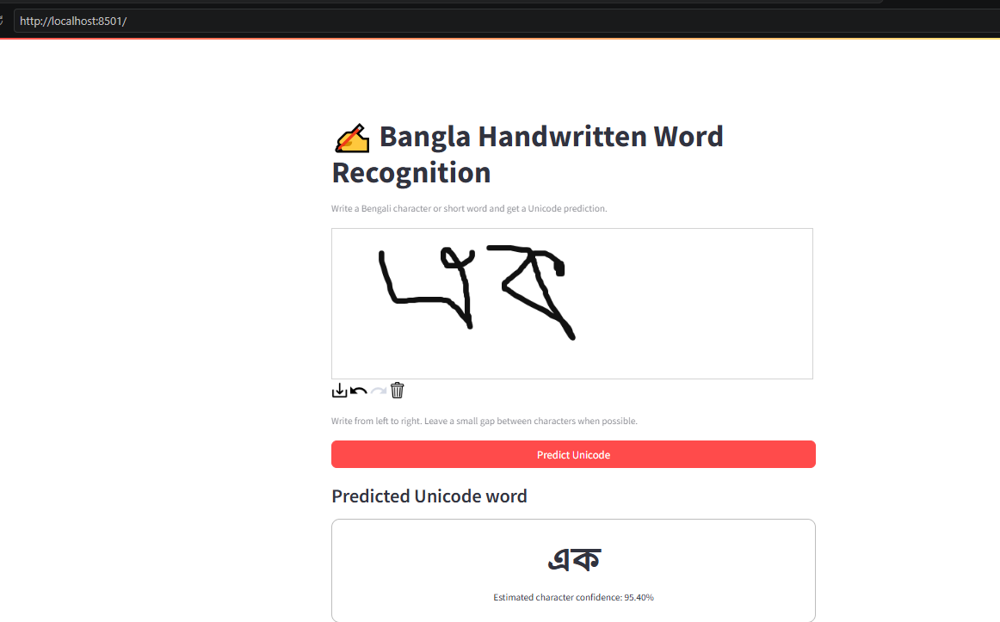
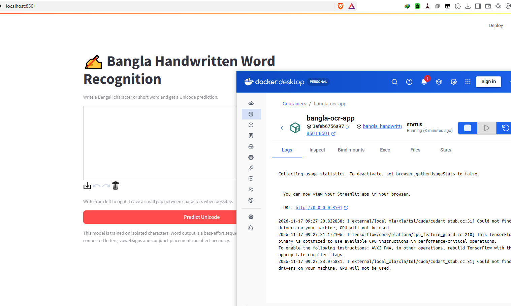

# Assignment : Bangla Handwritten Word Recognition System

**Student Name:** Md. Jahid Gazi  
**Student ID:** 1000128068  
**Program:** Skills for Industry Competitiveness and Innovation Program (SICIP)  
**Institution:** BRAC University  
**Bangla Handwritten Word Recognition System**
**Deadline:** 17 November 2026

---

## 1. Project objective

Build a Bangla handwritten word recognition system using the **BanglaLekha-Isolated** dataset. The project includes model training, MLflow experiment tracking, a Streamlit drawing interface, and Docker deployment.

The application must accept a handwritten Bangla word and display the predicted **complete joined word** in Bengali Unicode.

Examples of the required output:

| Handwritten input | Expected output |

|        জল        |      জল        |


## 2. Dataset

- **Dataset:** BanglaLekha-Isolated
- **Source:** [Mendeley Data — BanglaLekha-Isolated](https://data.mendeley.com/datasets/hf6sf8zrkc/2)

Download the dataset from the source and arrange it in the directory structure expected by `train.py`. The dataset is not included in the source-code submission ZIP.

The current training configuration recorded in MLflow used:

- Training images: 116,273
- Validation images: 24,916
- Number of classes: 84
- Input image size: 64 × 64

Keep `labels.json` and the class-to-Unicode mapping used by the application consistent with the trained model. Do not infer Bengali Unicode labels from numeric folder names unless the mapping has been verified.

## 3. Project Structure

The following is the recommended local project structure. The actual extracted dataset folder name may differ.

```text
Bangla_OCR_Assignment04/
│
├── app.py
├── train.py
├── requirements.txt
├── README.md
├── Dockerfile
├── .dockerignore
├── .gitignore
├── github_link.txt
│
├── labels.json
├── unicode_map.json
├── class_mapping.csv
├── class_contact_sheet.png
│
├── data/                         # Download and extract dataset here
│   └── BanglaLekha-Isolated/
│       └── [dataset files]
│
├── models/
│   └── model.keras               # Generated/saved trained model
│
├── artifacts/
│   └── mlflow/                   # MLflow tracking data, if configured here
│
├── mlflow/                       # Optional local MLflow database folder
├── mlruns/                       # Optional local MLflow tracking folder
│
├── notebooks/
│   └── Bangla_OCR_Assignment04.ipynb
│
├── screenshots/
│   ├── mlflow_experiment_1.png
│   ├── mlflow_experiment_2.png
│   ├── mlflow_experiment_3.png
│   ├── mlflow_experiment_4.png
│   ├── streamlit_app_1.png
│   ├── streamlit_app_2.png
│   └── streamlit_app_3.png
│
├── tools/
│   └── [supporting scripts]
│
└── .venv/                         # Local Python environment; do not upload
```

Only include files and screenshots that actually exist in your repository. Remove example entries from this tree if you do not have those files.

## 4. Environment Setup (WSL / Ubuntu)

Open a WSL terminal and go to the project directory:

```bash
cd ~/Bangla_OCR_Assignment04
```

Install Python virtual-environment support if needed:

```bash
sudo apt update
sudo apt install python3-venv python3-pip -y
```

Create and activate the virtual environment:

```bash
python3 -m venv .venv
source .venv/bin/activate
```

Upgrade pip and install the project dependencies:

```bash
python -m pip install --upgrade pip
python -m pip install -r requirements.txt
```

For running the Jupyter notebook using this environment:

```bash
python -m pip install ipykernel
python -m ipykernel install --user --name bangla-ocr --display-name "Python (Bangla OCR)"
```

In VS Code, open the notebook and select **Python (Bangla OCR)** as its kernel.

## 5. Verify the Dataset Folder

After extracting the dataset, check the `data/` directory:

```bash
cd ~/Bangla_OCR_Assignment04
ls -lah data/
find data/ -maxdepth 2 -type d | head -30
```

If the extracted dataset is nested in an additional folder, locate the directory that contains the class folders and configure `train.py` to use that directory.

Do not assume that the dataset path is `data/BanglaLekha-Isolated/` until you have checked the extracted archive.

## 6. Train the Model

Before training:

- Confirm that the dataset has been downloaded and extracted under `data/`.
- Confirm that the dataset path in `train.py` points to the correct directory.
- Confirm that the class labels and Unicode mapping correspond to the model's output classes.

Run training from the project root:

```bash
cd ~/Bangla_OCR_Assignment04
source .venv/bin/activate
python train.py
```

The training script should save the model and any required label files to the paths configured in `train.py`.

## 7. MLflow Experiment Tracking

The supplied MLflow screenshots show two completed training runs.

### Actual recorded experiment comparison

| Field | Run 1: `experiment_1_baseline` | Run 2: `experiment_2_lower_learning_rate` |
|---|---:|---:|
| Status | FINISHED | FINISHED |
| Training images | 116,273 | 116,273 |
| Validation images | 24,916 | 24,916 |
| Model architecture | 3-block CNN | 3-block CNN |
| Image size | 64 × 64 | 64 × 64 |
| Number of classes | 84 | 84 |
| Epochs | 8 | 10 |
| Batch size | 64 | 64 |
| Learning rate | 0.001 | 0.0005 |
| Training loss | 0.8614 | 0.9207 |
| Training accuracy | 75.61% | 74.19% |
| Validation loss | 0.5919 | 0.6648 |
| Validation accuracy | 83.79% | 82.12% |

**Observation:** Run 1 achieved higher validation accuracy (83.79%) and lower validation loss (0.5919) than Run 2. Run 2 used a lower learning rate and more epochs, but its recorded validation metrics were lower. These values are transcribed from the supplied MLflow screenshots.

### Start the MLflow UI

Use the same tracking URI/store configured in `train.py` or the notebook. For example, if the project uses the local file-based directory `artifacts/mlflow`, start the UI with:

```bash
cd ~/Bangla_OCR_Assignment04
source .venv/bin/activate
mkdir -p artifacts/mlflow
mlflow ui --backend-store-uri ./artifacts/mlflow --host 0.0.0.0 --port 5000
```

Open:

[http://localhost:5000](http://localhost:5000)

If your code uses a SQLite tracking URI or another tracking directory, change the UI command to use that exact same store. Do not point the UI to a different tracking store, or the experiment runs may not appear.

At least two successful MLflow training runs are required. The supplied screenshots show two runs with `FINISHED` status.

## 8. Run the Streamlit Application

Open another WSL terminal:

```bash
cd ~/Bangla_OCR_Assignment04
source .venv/bin/activate
streamlit run app.py
```

Open:

[http://localhost:8501](http://localhost:8501)

Write from left to right, leave a small gap between characters when possible, and click **Predict Unicode**. The application should display the predicted joined Bengali Unicode output.

The output is a prediction and may be incorrect. The current isolated-character model and segmentation approach have the limitations described above.

## 9. Docker Build and Run

Docker image names must be lowercase. Use this image name based on the project title:

```text
bangla_handwritten_character_word_recognition_system
```

Build from the project root:

```bash
sudo docker build -t bangla_handwritten_character_word_recognition_system .
```

Run the container:

```bash
sudo docker run --rm -p 8501:8501 bangla_handwritten_character_word_recognition_system
```

Open:

[http://localhost:8501](http://localhost:8501)

Make sure the `Dockerfile` installs the dependencies, exposes port `8501`, and starts `app.py` with Streamlit. The container must have access to the model and mapping files required by the application.

## 9. Screenshots:

Include screenshots in the GitHub repository showing:

- The MLflow experiment page with at least two training runs.
- The Streamlit page with a handwritten Bangla word and its predicted complete Bangla Unicode output.

### MLflow Training Experiments

**Run 1 – Baseline Experiment**


**Run 2 – Lower Learning Rate**


**Additional MLflow Evidence**




### Streamlit Application

**Prediction Example 1**



**Prediction Example 2**


**Prediction Example 3**



**After Docker Build**



## 11. GitHub repository: 

https://github.com/md-jahid-gazi/Bangla_Handwritten_Character_-_Word_Recognition_System


## 12. Limitations

- The CNN is trained on isolated character images, rather than complete handwritten-word images.
- Word segmentation and concatenation may not correctly handle connected Bangla handwriting.
- Vowel signs, conjuncts, phala, overlapping strokes, and small gaps can affect segmentation and recognition.
- Unicode output depends on a correct and complete class-to-Unicode mapping.
- The recorded validation accuracy measures the isolated-character classification task; it is not a word-level OCR accuracy score.

A future improvement is to train and evaluate a sequence-based word recognition model using a dataset with complete handwritten-word images and corresponding word-level transcriptions.


